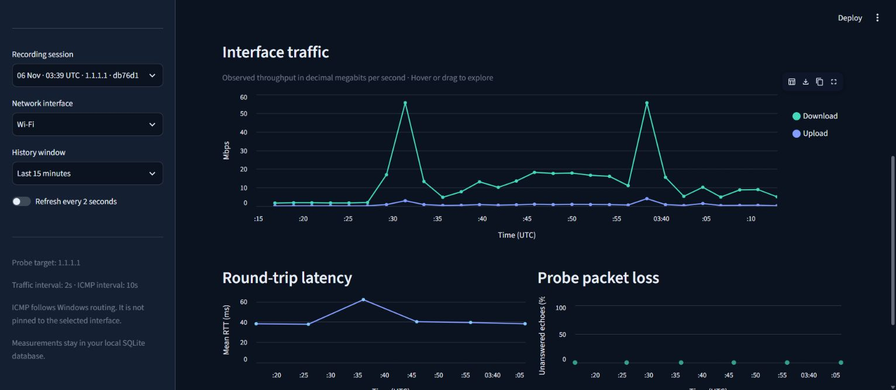
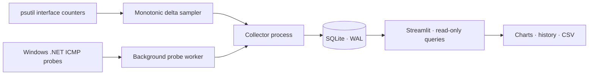

# NetScope — Network Monitoring & Analytics

Live site: [https://ahmedsakib1113.github.io/netscope/](https://ahmedsakib1113.github.io/netscope/)

The public web demo explores a real recorded session. Run the Windows collector and Streamlit dashboard locally for live monitoring.

A Windows-first Python project that turns real laptop network measurements into an interactive dashboard and a queryable history. Built to connect networking concepts with data collection, SQL and exploratory analysis.

**Phase 1:** interface throughput, ICMP round-trip latency, probe packet loss, local persistence and tests.



The screenshot shows a completed real capture. Recorded values remain available after the collector stops. See the [overview screenshot](docs/dashboard-overview.png) for the metric cards and session controls.

## Hosted preview

The [live site](https://ahmedsakib1113.github.io/netscope/) is an interactive view of a completed real Wi-Fi recording, with history windows, throughput/latency charts, measurement definitions, and a traffic CSV download. It displays historical data; it does not monitor the visitor's computer.

The preview lives in `docs/` and is hosted for free with GitHub Pages. To refresh its minimal public snapshot from a completed local recording against `1.1.1.1`:

```powershell
.\.venv\Scripts\python.exe scripts/export_web_demo.py
```

The exporter opens SQLite read-only. It exports timing, throughput, probe results, and quality labels; the raw database, machine identifiers, other interfaces, and private target addresses remain local. Preview calculations can be checked with `node --test tests/web-demo.test.mjs` (Node 20+).

## What it does

- Reads actual per-interface byte counters with `psutil` and calculates upload/download rates using elapsed monotonic time.
- Sends small ICMP echo batches to a configurable IP address using Windows PowerShell and .NET `Ping`.
- Stores timestamped measurements and recording sessions in SQLite.
- Displays live values, traffic charts, latency and loss history, recording status and CSV exports in Streamlit.
- Keeps recording independently of the dashboard and marks old data as stale or stopped.
- Handles adapter resets, disconnects and measurement errors without inventing zeros.

This monitors the laptop's interfaces and a route to one target. It is not a Wi-Fi device scanner, packet capture tool or internet speed test. VPN and virtual interface counters can overlap, so their traffic is never added together.

## Run on Windows

Requirements: **Python 3.12+**, Windows 10/11 and Windows PowerShell with .NET ICMP support. Normal Windows installations do not require an administrator terminal. Policies or endpoint protection may block ICMP.

Open PowerShell in the `netscope` directory:

```powershell
python -m venv .venv
.\.venv\Scripts\python.exe -m pip install -r requirements-lock.txt
.\.venv\Scripts\python.exe -m pip install -e . --no-deps
```

Start recording in one terminal:

```powershell
.\.venv\Scripts\python.exe -m netscope collect
```

Open a second terminal in the same directory:

```powershell
.\.venv\Scripts\python.exe -m streamlit run dashboard.py
```

Visit **http://127.0.0.1:8501**. Alternatively, after setup, double-click `start-collector.cmd` and `start-dashboard.cmd`. Press **Ctrl+C** in the collector terminal to stop; an in-flight probe batch is allowed to finish before the session is closed. Closing the dashboard does not stop the collector.

The original development folder already has its private Python environment installed. Start with the two run commands above.

## Choose what to monitor

```powershell
# List exact interface names, without printing IP or MAC addresses.
.\.venv\Scripts\python.exe -m netscope interfaces

# Record Wi-Fi for one minute; defaults are 2s traffic samples and 10s probe batches.
.\.venv\Scripts\python.exe -m netscope collect --interface "Wi-Fi" --duration 60

# Use a different target (for example your router's numeric IP).
.\.venv\Scripts\python.exe -m netscope collect --target 1.1.1.1 --interval 2 --probe-interval 10 --count 4 --timeout-ms 1000

# Test the local IP stack; loopback latency is not an internet latency measurement.
.\.venv\Scripts\python.exe -m netscope collect --target 127.0.0.1 --duration 15
```

The default target is `1.1.1.1`. Numeric unicast IPv4/IPv6 addresses are accepted; hostnames and scoped IPv6 addresses are not supported in Phase 1. ICMP uses the Windows routing table and is **not bound to the interface selected in the dashboard**. With a VPN enabled, the probe may follow the VPN route.

Change the database location with `--db C:\path\netscope.sqlite3`. To display that database, set `$env:NETSCOPE_DB = 'C:\path\netscope.sqlite3'` in the dashboard terminal before starting Streamlit. Otherwise both programs use the project's `data/netscope.sqlite3`, independent of the terminal's directory.

## Read the measurements correctly

| Metric | Calculation and meaning |
| --- | --- |
| Download / upload | `counter_delta_bytes × 8 / elapsed_seconds / 1,000,000`; decimal Mbps of observed traffic |
| Mean latency | Mean RTT of successful ICMP replies in the last completed batch, in milliseconds |
| Batch packet loss | `(completed_requests − successful_replies) / completed_requests × 100` |
| Window packet loss | Same formula after summing request/reply counts over valid batches in view |
| Missing rate | First observation, disconnected/reconnected interface, decreasing counter or invalid time interval |
| Measurement error | Probe execution failed; excluded from loss rather than reported as network loss |

Four-request batches produce 0%, 25%, 50%, 75% or 100% loss, so short runs are coarse estimates. ICMP filtering or deprioritization can differ from application traffic. No echo replies alone cannot prove an internet outage. Windows returns integer RTT milliseconds, including 0 ms for very fast replies.

All timestamps are stored as Unix seconds in UTC. The dashboard labels chart times in UTC. The history window is anchored to the session's last interface sample so stopped recordings remain inspectable; at most 5,000 interface samples and 1,000 probe batches are displayed. A database lock allows only one collector per database. If a process is killed, its session may have no end timestamp; the dashboard still marks old readings as stale.

## Architecture



Bandwidth sampling and ICMP run independently. A probe batch cannot hold up the sampling loop. SQLite writes are short, use foreign keys, and store explicit recording sessions. The dashboard opens read-only database connections; it does not spawn collectors or generate demo measurements.

```text
src/netscope/
  bandwidth.py    # psutil reads and counter delta calculations
  probes.py       # Windows ICMP adapter and batch aggregation
  collector.py    # sampling loop, independent probe worker, clean shutdown
  storage.py      # schema, sessions, writes and read-only history
  locking.py      # automatically released single-collector lock
  analytics.py    # weighted loss and freshness status
  cli.py         # validated command-line options
dashboard.py     # Streamlit UI
tests/           # deterministic calculations, persistence and UI checks
docs/            # design decisions and validation evidence
```

See [design decisions](docs/architecture.md) and [validation evidence](docs/validation.md).

## Tests

```powershell
.\.venv\Scripts\python.exe -m pytest -q
```

Tests use deterministic counters and mocked probes; they do not contact external hosts. They cover rates and units, timing, resets, reconnections, ICMP success/timeouts/errors, target validation, weighted loss, database persistence/integrity/read-only access, collector locks and shutdown, and the real Streamlit app rendering database records. The included Windows GitHub Actions workflow runs the suite on pushes and pull requests.

`requirements-lock.txt` records the exact environment used for local verification. `pyproject.toml` declares compatible dependency ranges. Live ICMP collection is Windows-only; the pure calculations and storage are portable.

## Data and project scope

`data/`, databases, virtual environments, exports and temporary artifacts are ignored by Git. Stored data contains interface names, counters, timestamps, probe targets and outcomes, but no packet payloads, browsing history or process lists. No telemetry is sent by NetScope; ICMP echo requests go to the configured target, and Streamlit usage statistics are disabled. The dashboard binds to `127.0.0.1`.

Storage grows until you archive or remove recordings yourself; automatic retention is not included yet. For long-term monitoring, place the database outside a cloud-synced folder. This avoids file-sync conflicts while SQLite is active. Stop the collector before archiving the database.

Phase 1 is intentionally focused. Future work can add historical summaries, well-evaluated anomaly detection, and a separate Cisco switching lab with documented VLANs and EtherChannel. Packet Tracer data would require a supported integration/export and will not automatically appear here.

## Portfolio demonstration

1. Start the collector and dashboard, choose your active adapter and open a normal website or download a file.
2. Explain why traffic rises, how bytes become Mbps, and why a VPN can expose overlapping counters.
3. Compare traffic changes with latency and loss without claiming causation from a short sample.
4. Stop the collector, inspect the preserved history and export a CSV for analysis.
5. Walk through a reset/error test and explain why missing observations must not become zeros.

## References

- [psutil documentation](https://psutil.io/)
- [Microsoft .NET Ping.Send](https://learn.microsoft.com/en-us/dotnet/api/system.net.networkinformation.ping.send)
- [Streamlit fragments](https://docs.streamlit.io/develop/api-reference/execution-flow/st.fragment)
- [Streamlit AppTest](https://docs.streamlit.io/develop/api-reference/app-testing/st.testing.v1.apptest)
